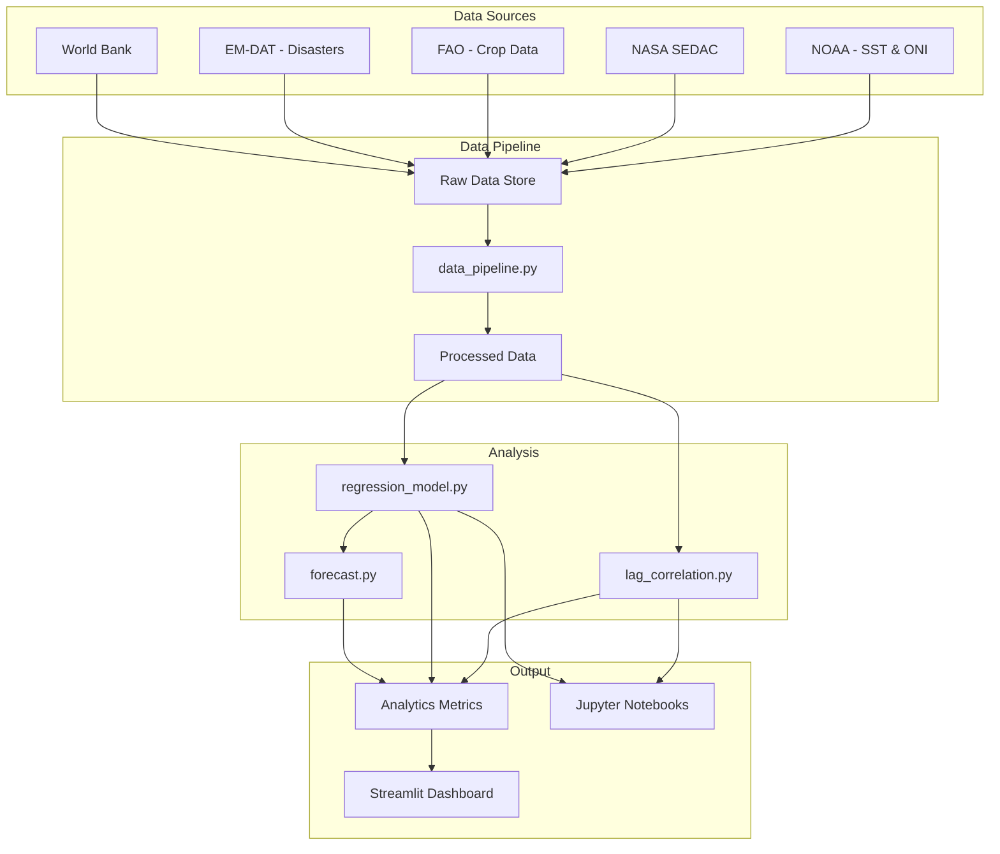

# ENSO Climate Analytics: Monitoring Climate Anomalies, Economic Losses & Food Security

[](https://github.com/samalarakshithbabu/enso-climate-analytics/stargazers)
[](https://github.com/samalarakshithbabu/enso-climate-analytics/network)
[](https://github.com/samalarakshithbabu/enso-climate-analytics/issues)
[](https://github.com/samalarakshithbabu/enso-climate-analytics/blob/main/LICENSE)


An end-to-end climate intelligence and business analytics dashboard evaluating Equatorial Pacific Sea Surface Temperatures (SST), El Niño & La Niña cycles, global agricultural yields, and socio-economic vulnerabilities. This framework bridges spatial climate data and policy analytics to empower data-driven climate resilience and disaster risk reduction.

---

## System Architecture



---

## Problem Statement

El Niño-Southern Oscillation (ENSO) cycles drive global climate anomalies affecting agriculture, disaster frequency, and economic stability. Decision-makers need integrated analytics connecting oceanic indices (ONI), disaster events (EM-DAT), crop production (FAO), and population vulnerability (NASA SEDAC) for proactive risk management.

## Objectives

- Monitor real-time and historical ONI (Oceanic Niño Index) anomalies
- Quantify economic losses and population impact from ENSO-driven disasters
- Analyze agricultural yield vulnerability across major producing regions
- Provide policy-relevant insights for disaster risk reduction and food security planning

## Key Features

### Executive Dashboards (4 Views)

1. **ENSO Conceptual Overview** - Dual-hemispheric visualization of El Niño/La Niña atmospheric divides
2. **La Niña Global Impact (2020-2023)** - 448 events, $535B damage, hydrological (41.73%) vs meteorological (27.51%) breakdown
3. **El Niño Climate Disaster Analytics** - 530 events, ONI peak 2.30, 14 major droughts, 38M peak annual population affected
4. **Global Agricultural & Food Security** - 12.45B total production, 5.32B hectares harvested, $278.6B economic losses, 235.7M people affected

### Key Verified Insights

- **Triple-Dip La Niña Impact (2020-2023)**: $535B cumulative damages, hydrological events = 41.73% of disaster subgroups
- **Thermal Sensitivity & Human Exposure**: El Niño peaks (ONI 2.30) correspond to 30M+ affected annually during active windows
- **Agricultural Yield Risk**: $278.6B losses across 5.32B hectares, driving staple grain commodity volatility

## System Architecture

```
data/
├── raw/                  # Downloaded raw data (immutable)
├── processed/            # Cleaned, merged datasets
└── output/               # Model outputs, forecasts

src/
├── data_pipeline.py      # Pull ONI, SST, climate data
├── lag_correlation.py    # ENSO-lag-crop analysis
├── regression_model.py   # ENSO → crop yield regression
└── forecast.py           # Simple forecast with backtest

notebooks/
├── analysis.ipynb        # Interactive analysis
└── dashboard.py          # Streamlit dashboard
```

## Methodology

### 1. Lag Correlation Analysis
- Pearson correlation between ONI and crop yields at lags 0-24 months
- Optimal lag identification per region-crop combination
- Significance testing (p < 0.05)

### 2. Regression Model
```
Yield = β₀ + β₁·ONI_lag + β₂·Precipitation + β₃·Temperature + ε
```
- OLS regression with robust standard errors
- Regional fixed effects where sample size permits
- Model selection via AIC/BIC

### 3. Forecasting
- Holt-Winters exponential smoothing on ONI series
- Simple crop yield projection using historical elasticities
- Backtest: Rolling 5-year forecast → evaluate RMSE vs actual

### 4. Validation
- Cross-validation: 5-fold rolling origin
- Out-of-sample testing: Hold out 2019-2023 for final validation
- Sensitivity analysis on lag specification

## Technology Stack

| Component | Technology |
|-----------|------------|
| Business Intelligence | Microsoft Power BI / Tableau |
| ETL & Transformation | Power Query, Python (Pandas, NumPy) |
| Data Sources | NOAA (SST & ONI), NASA SEDAC, FAO, World Bank |
| Data Modeling | Advanced DAX metrics for rolling anomalies, variance, ranking, predictive yield loss indices |

## Data Sources

| Source | Data Type | URL | Access |
|--------|-----------|-----|--------|
| NOAA CPC - ONI Index | Oceanic Niño Index (3-month running mean) | https://www.cpc.ncep.noaa.gov/data/indices/oni.shtml | Public |
| NOAA PSL - Climate Indices | PDO, SOI, AO indices | https://www.psl.noaa.gov/data/climateindices/list/ | Public |
| NOAA OI SST | Optimally Interpolated SST | https://www.ncei.noaa.gov/products/optimum-interpolation-sst | Public |
| FAO - FAOSTAT | Crop production, yields, land use | https://www.fao.org/faostat/en/#data | Public |
| EM-DAT | Natural disaster events & economic losses | https://www.emdat.be/ | Public/Credits |
| World Bank - Climate Data | Temperature, precipitation by country | https://climateknowledgeportal.worldbank.org/ | Public |

## Pipeline Commands

```bash
# Pull all data sources
python src/data_pipeline.py

# Run lag correlation analysis
python src/lag_correlation.py

# Fit regression models
python src/regression_model.py

# Generate forecasts with backtest
python src/forecast.py

# Launch interactive dashboard
streamlit run notebooks/dashboard.py
```

## Limitations

- **NOAA ONI**: 3-month lag for finalized values; ERSSTv5 may have historical discontinuities
- **FAO Data**: Annual resolution misses intra-seasonal effects; reporting gaps for some countries
- **EM-DAT**: Event threshold excludes smaller disasters; economic loss estimates uncertain
- **Correlation ≠ Causation**: ONI-crop relationships vary regionally; confounding factors exist
- **No live deployment**: Dashboard screenshots from local development only

---

## Author

**SAMALA RAKSHITH BABU**  

**Contact:**  
- Email: samalarakshithbabu7@gmail.com  
- LinkedIn: https://www.linkedin.com/in/samala-rakshith-babu/  
- GitHub: https://github.com/samalarakshithbabu  

---

## License

MIT License - See LICENSE file for details.

---

## Citation

If you use this project, analytical framework, or dataset integrations in your research or applications, please cite it as:

```bibtex
@misc{ENSOAnalytics2026,
  author = {Samala Rakshith Babu},
  title = {ENSO Analytics: Monitoring Climate Anomalies, Economic Losses, and Population Vulnerability},
  year = {2026},
  publisher = {GitHub},
  journal = {GitHub repository},
  howpublished = {\url{https://github.com/samalarakshithbabu/enso-climate-analytics}}
}
```